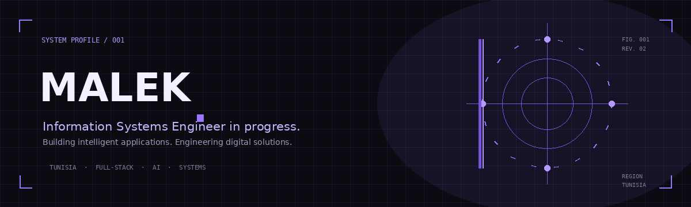

  

  **INFORMATION SYSTEMS ENGINEERING · MASTER'S STUDENT**

  Building intelligent applications, exploring AI, and engineering digital solutions.

---

## 01 / IDENTITY

### About me

I'm Malek, a Master's student in **Information Systems Engineering** with a background in software engineering.

I enjoy understanding how digital systems work as a whole, from designing user-facing applications to building the backend logic and data structures that power them.

My interests sit at the intersection of **full-stack development, artificial intelligence, and intelligent software systems**. I like experimenting with ideas, exploring technical solutions, and turning concepts into functional applications.

Currently, I'm focused on strengthening my engineering foundations, exploring applied AI, and building projects that combine practical software development with intelligent technologies.

 

| CURRENT FOCUS | EXPLORING |
|:---|:---|
| Full-stack application development | Applied AI & Machine Learning |
| Backend architecture & databases | Intelligent systems |
| Software engineering | Building practical digital products |

 

---

## 02 / TECHNICAL DNA

### Technologies & tools

A collection of technologies I've worked with across application development, backend engineering, databases, and intelligent software projects.

**01 / APPLICATION ENGINEERING**

  

**02 / BACKEND & DATA**

  

**03 / PROGRAMMING & AI**

  

**04 / ENGINEERING TOOLS**

  

ALSO WORKED WITH: SOCKET.IO · CLOUDINARY · OLLAMA

BASED IN TUNISIA · CURRENTLY PURSUING A MASTER'S DEGREE

